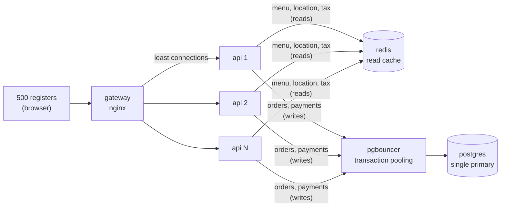

# Scaling to 500 registers

How the stack in `compose.yaml` handles 500 cashier registers at peak, what each piece is for,
and where the limits are. The load test in `load/checkout.js` simulates exactly this and runs in CI.

## Architecture



| Piece | Scales by | Why |
|---|---|---|
| gateway (nginx) | one is plenty; add more behind a cloud LB if needed | Serves the static register UI and load-balances `/v1` to the replica with the fewest in-flight requests. Re-resolves the `api` name every 5 s, so scaling replicas needs no restart. |
| api | `docker compose up -d --scale api=N` (default 3) | Stateless: no sessions, no local caches that must agree. Any replica can serve any request, which is what makes the gateway's load balancing safe. |
| redis | one instance (cache only, no persistence) | Absorbs the read traffic: every quote, menu load and location load. If it fails, requests fall back to Postgres (with a 250 ms timeout) instead of failing. |
| pgbouncer | one instance | Lets any number of API replicas share a fixed number of Postgres connections. |
| postgres | vertically (CPU, RAM, fast disk) | Single primary is the source of truth for every write. |

## What 500 registers actually asks of the system

Assume a busy peak: every register rings up a sale every 45 seconds. That is about **11 sales per
second** across the fleet. One sale, as the register UI makes it:

| Call | Per sale | Per second | Served by |
|---|---|---|---|
| `GET /locations/{id}/menu-items` | 1 | 11 | Redis |
| `POST /orders/quote` (one per cart change) | ~3 | 33 | Redis + CPU, no database |
| `POST /orders` | 1 | 11 | Postgres write |
| `POST /orders/{id}/payments` | 1 (+5% declines) | 12 | Postgres write |

**Writes:** creating an order is one transaction (claim idempotency key, bump the location's order
counter, insert the order and ~3 lines, complete the key: about 7 rows). Paying is one more (claim key,
insert payment, update order, complete key: about 4 rows). That is roughly **25 write transactions
and ~120 row changes per second**. A single Postgres primary on modest hardware sustains thousands of
small transactions per second, so the write path has more than **10x headroom**. The load test runs
at about 4x this rate (a sale every ~12 s per register).

**Reads:** about 45 per second, all from Redis. Without the cache, every quote would be two queries,
which at a lunch rush is the bulk of database load. With it, Postgres sees only the writes.

## Measured

The CI load test (500 registers, full sales, 2-minute peak) on a GitHub-hosted runner, where the whole
stack *and* the load generator share one small VM:

| | |
|---|---|
| Sales completed | 8,410 (48 sales/s, about 4x the estimate above) |
| Requests | 46,831 (269/s) |
| Failed requests | 0.00% |
| p50 / p95 / p99: menu | 1 / 5 / 15 ms |
| p50 / p95 / p99: quote | 1 / 5 / 12 ms |
| p50 / p95 / p99: create order | 6 / 20 / 38 ms |
| p50 / p95 / p99: pay | 4 / 13 / 23 ms |

Writes are the slowest calls, as expected, and still well under the 600 ms budget. Every push re-runs
this test, and the numbers are on each CI run's summary page.

## How writes are kept safe and cheap

Writes stay on one primary on purpose. Splitting money-moving writes across databases (sharding,
multi-primary) adds distributed-transaction problems this load doesn't come close to needing. Instead,
the single primary is protected:

- **Short transactions.** Each request is one transaction of a few small statements. Nothing slow
  (no network calls; the card processor is called inside the transaction only because it's a mock,
  see "Next steps") holds row locks.
- **Connection pooling (PgBouncer, transaction mode).** 3 replicas x 20 connections, or 50 replicas
  x 20, all share 40-50 real Postgres connections. Postgres performance drops with hundreds of
  connections, so this is what lets the API scale horizontally without hurting the database.
  Migrations bypass PgBouncer because Flyway needs a session-level lock.
- **Cached reads, authoritative writes.** Quotes may use a menu snapshot up to 60 s old. Creating an
  order always re-reads prices and availability from Postgres inside its transaction, so a stale
  cache can never put a wrong price or a sold-out item on a real order (see `CachingTests`).
- **Idempotency in the same transaction as the work.** A retry with the same key waits for the first
  request to finish and replays its result. No second order, no double charge, and a unique index on
  captured payments backs this up in the database itself.
- **Optimistic locking** (`version` / `If-Match`) instead of long row locks for order updates.
- **Bounded table growth.** Expired idempotency keys (24 h) are deleted every 10 minutes in batches of
  5,000 with `SKIP LOCKED`, so every replica can run the job without contending.
- **Integer money and database constraints**, so concurrent writers can't produce inconsistent totals.

## Known hot spot

Each location has one order-number counter row (`location.next_order_number`), updated in every
order transaction. Registers at the **same** location therefore create orders one at a time for a few
milliseconds each, roughly 100+ orders per second per location before it matters. Kiosks have a
handful of registers each, so 500 registers spread over many locations never get close. If one site
ever needed more, move pickup numbers to a per-location Postgres sequence or a Redis `INCR`.

## Running it

```bash
docker compose up -d --build                         # everything, 3 API replicas
docker compose up -d --scale api=6                   # more replicas, no restart of anything else
docker compose --profile loadtest run --rm k6        # 500 registers for 3 minutes
REGISTERS=1000 DURATION=5m docker compose --profile loadtest run --rm k6
```

Results print at the end and are saved to `load/results/`. CI runs the same test (2 minutes) on every
push and fails the build if more than 1% of requests fail or p95 latency exceeds 300 ms for reads
or 600 ms for writes.

## Next steps beyond this

In rough order of when they'd be needed:

1. **Take the card processor call out of the database transaction** once it's a real network call:
   record the attempt as `PENDING`, call the processor, then finalize. Keeps lock time independent of
   processor latency.
2. **Read replica** for reporting and order history, so analytics never compete with checkout writes.
3. **Redis high availability** (Sentinel or a managed service) so a cache failover doesn't briefly
   push all reads to Postgres.
4. **Partition `customer_order` and `payment` by month** once they reach hundreds of millions of rows,
   to keep indexes small and make archiving a `DROP PARTITION`.
5. **Run on an orchestrator** (Kubernetes, ECS) to autoscale API replicas on CPU or request rate. The
   readiness and liveness endpoints are already in place.
